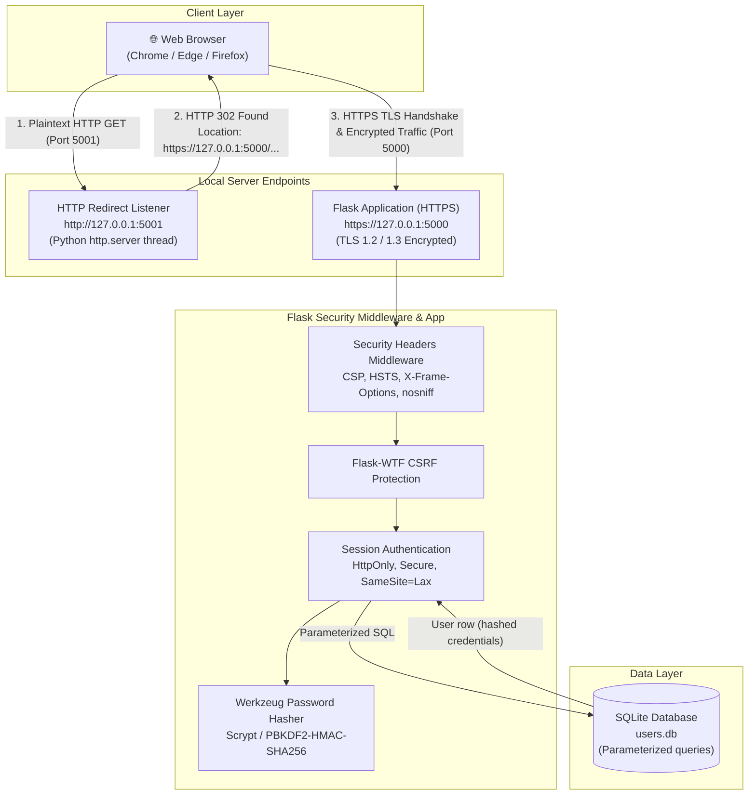

# SSL/TLS-Enabled Secure Web Application

**Prepared by Roshan — B.Tech CSE, 5th Semester**  
**Cyber Security Laboratory Project**

---

## 1. Project Abstract & Problem Statement

### Abstract
In modern web applications, the transmission of authentication credentials and session tokens over unencrypted channels exposes users to severe security vulnerabilities, including passive packet sniffing, session hijacking, credential harvesting, and Man-in-the-Middle (MitM) attacks. This project implements a secure, production-patterned web application developed with Python Flask and SQLite, engineered specifically to demonstrate transport-layer security (TLS/HTTPS), end-to-end cryptographic safeguards, defense-in-depth HTTP response headers, session fixation prevention, and cross-site request forgery (CSRF) mitigation.

### Problem Statement
Standard web traffic using HTTP transmits requests and responses in plaintext. Eavesdroppers on the same network (e.g., public Wi-Fi or compromised routers) can inspect passwords, cookies, and sensitive user data in transit. Furthermore, simple web applications frequently fail to implement defense-in-depth controls such as secure cookie attributes (`HttpOnly`, `Secure`, `SameSite`), timing-safe password hashing, parameterized database queries, and automatic redirection of insecure traffic to encrypted channels.

### Objectives
1. **Transport Layer Encryption:** Bind Flask with an SSL/TLS context to enforce TLS encrypted transport on `https://127.0.0.1:5000`.
2. **HTTP-to-HTTPS Redirection:** Implement an auxiliary HTTP listener on `http://127.0.0.1:5001` that returns an HTTP `302 Found` redirection pointing to the HTTPS origin without open-redirect vulnerabilities.
3. **Cryptographic Credential Storage:** Enforce Werkzeug salted password hashing (PBKDF2/Scrypt) and forbid plaintext storage.
4. **Session & Cookie Hardening:** Configure signed server-side session cookies with `HttpOnly`, `Secure`, and `SameSite=Lax` attributes.
5. **Defense-in-Depth Headers:** Implement Content-Security-Policy (CSP), Strict-Transport-Security (HSTS), X-Frame-Options (DENY), and X-Content-Type-Options (nosniff).
6. **CSRF & Injection Defense:** Protect all state-changing endpoints with Flask-WTF anti-CSRF tokens and SQLite parameterized queries.

---

## 2. Technology Stack

- **Backend:** Python 3.10+ (Flask 3.x, Werkzeug, Flask-WTF, python-dotenv)
- **Frontend:** Semantic HTML5, Vanilla CSS3 (Custom Dark Navy/Charcoal Design System), Vanilla JavaScript (No React, Node.js, or heavyweight dependencies)
- **Database:** SQLite3 (parameterized queries with `?` placeholders)
- **Cryptography:** OpenSSL / Python `cryptography` library for X.509 self-signed certificates, Werkzeug for PBKDF2/Scrypt password hashing
- **Testing:** Python standard library `unittest`

---

## 3. System Architecture



---

## 4. Project Folder Structure

```
cs project/
├── certs/
│   ├── cert.pem             # X.509 Development Certificate (2048-bit RSA)
│   └── key.pem              # RSA Private Key
├── docs/
│   ├── architecture.md      # Detailed system architecture & Mermaid diagrams
│   ├── testing.md           # Test suite guide & Wireshark verification steps
│   └── viva.md              # 15 Viva questions and answers for oral examination
├── static/
│   ├── css/
│   │   └── style.css        # Professional dark navy/charcoal responsive CSS
│   └── js/
│       └── main.js          # Vanilla JavaScript (password toggle, auto-dismiss, strength meter)
├── templates/
│   ├── base.html            # Jinja2 layout base with navigation & security badge
│   ├── index.html           # Landing page with architecture & feature overview
│   ├── register.html        # Registration form with CSRF and validation
│   ├── login.html           # Login form with CSRF and generic error responses
│   ├── dashboard.html       # Authenticated dashboard displaying active controls
│   ├── security.html        # Security documentation and control matrix
│   ├── 404.html             # Custom 404 Not Found error template
│   └── 500.html             # Custom 500 Internal Error template
├── tests/
│   ├── __init__.py
│   └── test_app.py          # 26 automated unit tests covering all requirements
├── .env.example             # Template for environment configuration
├── .gitignore               # Ignores keys, virtual environments, caches, and DBs
├── app.py                   # Main Flask application and HTTP redirect listener
├── gen_cert.bat             # Batch launcher for certificate generation
├── gen_cert.py              # Python script generating self-signed certificates with SAN
├── requirements.txt         # Python package dependencies
├── start.bat                # Windows double-click launcher
└── README.md                # Project documentation (this file)
```

---

## 5. Windows PowerShell Setup & Run Instructions

### Step 1: Open PowerShell in the Project Directory
```powershell
cd "c:\Users\Asus Zenbook\OneDrive\Desktop\CODING\cs project"
```

### Step 2: Install Python Dependencies
The project uses the Python launcher (`py`) or `python`. Install dependencies using:
```powershell
py -m pip install -r requirements.txt
```
*(Or with standard python: `python -m pip install -r requirements.txt`)*

### Step 3: Generate Local Development Certificates (If Not Already Present)
Run the automated certificate generator:
```powershell
py gen_cert.py
```
*(Or double-click `gen_cert.bat`)*

This creates `certs/cert.pem` and `certs/key.pem` with Subject Alternative Names (SAN) for `127.0.0.1` and `localhost`.

### Step 4: Run the Automated Test Suite
Verify that all 26 tests pass:
```powershell
py -m unittest discover -s tests -v
```

Expected output:
```
test_404_for_unknown_route ... ok
test_home_page_loads ... ok
test_security_page_loads ... ok
test_get_returns_302_to_https_origin ... ok
test_redirect_does_not_include_external_host ... ok
test_login_nonexistent_user_shows_generic_error ... ok
test_login_sets_user_id_in_session ... ok
test_login_success_redirects_to_dashboard ... ok
test_login_wrong_password_shows_generic_error ... ok
test_dashboard_inaccessible_after_logout ... ok
test_logout_clears_session_and_redirects ... ok
test_password_stored_as_hash_not_plaintext ... ok
test_register_duplicate_username ... ok
test_register_duplicate_username_case_insensitive ... ok
test_register_password_mismatch ... ok
test_register_password_too_short ... ok
test_register_success ... ok
test_register_username_too_short ... ok
test_content_security_policy_present ... ok
test_hsts_absent_on_http ... ok
test_referrer_policy ... ok
test_x_content_type_options ... ok
test_x_frame_options ... ok
----------------------------------------------------------------------
Ran 26 tests in 3.014s

OK
```

### Step 5: Start the Application
Run the application server:
```powershell
py app.py
```
*(Or double-click `start.bat`)*

Console startup output:
```
==============================================================
  SSL/TLS-Enabled Secure Web Application
  Cyber Security Project — B.Tech 5th Semester
==============================================================
  HTTPS (main app)   : https://127.0.0.1:5000
  HTTP   (redirect)  : http://127.0.0.1:5001

  Browser warning expected - self-signed certificate.
  Click: Advanced -> Proceed to 127.0.0.1 (unsafe)
==============================================================
```

---

## 6. Demonstration & Verification Guide

### 1. Browser Certificate Inspection
1. Open `https://127.0.0.1:5000` in Google Chrome, Microsoft Edge, or Firefox.
2. The browser displays a warning because the certificate is self-signed:
   - Click **Advanced** -> **Proceed to 127.0.0.1 (unsafe)**.
3. Click the padlock or "Not secure" icon in the address bar and select **Certificate details**:
   - Confirm Common Name: `127.0.0.1`
   - Confirm Subject Alternative Names: `IP:127.0.0.1, DNS:localhost`
   - Confirm Public Key: RSA 2048 bits

### 2. HTTP-to-HTTPS Redirection
1. Open a new PowerShell terminal while the server is running.
2. Send an HTTP request to port 5001:
   ```powershell
   curl -I http://127.0.0.1:5001/dashboard
   ```
3. Observe the response:
   ```http
   HTTP/1.0 302 Found
   Location: https://127.0.0.1:5000/dashboard
   ```
   *The redirect explicitly directs the client to the HTTPS listener on port 5000.*

### 3. Response Headers & Cookie Flags in DevTools
1. Press `F12` in your browser to open Developer Tools.
2. Select the **Network** tab, refresh the page, and select `127.0.0.1`.
3. Check the **Response Headers**:
   - `Strict-Transport-Security: max-age=31536000; includeSubDomains`
   - `Content-Security-Policy: default-src 'self'; ...`
   - `X-Frame-Options: DENY`
   - `X-Content-Type-Options: nosniff`
   - `Referrer-Policy: strict-origin-when-cross-origin`
4. Check the **Application** -> **Cookies** tab:
   - `session` cookie has `HttpOnly: true`, `Secure: true`, and `SameSite: Lax`.

### 4. Password Hash Verification in Database
1. Register a test account at `https://127.0.0.1:5000/register`.
2. Inspect the SQLite database in PowerShell:
   ```powershell
   py -c "import sqlite3; conn = sqlite3.connect('users.db'); print(conn.execute('SELECT id, username, password_hash FROM users').fetchall())"
   ```
3. Observe that only the salted hash (e.g. `scrypt:...` or `pbkdf2:...`) is stored.

---

## 7. Security Controls & Development Limitations

| Security Control | Implementation | Production Difference |
|---|---|---|
| **TLS Encryption** | Python `ssl` context with self-signed certificate | Production uses trusted CA certificate (e.g., Let's Encrypt / DigiCert) |
| **HTTP Redirection** | Auxiliary `http.server` on port 5001 | Production uses reverse proxy (Nginx / Cloudflare) redirecting port 80 to 443 |
| **Password Storage** | Werkzeug Scrypt / PBKDF2-HMAC-SHA256 with random salt | Same standard applied in production |
| **Session Security** | Flask signed cookies with `HttpOnly`, `Secure`, `SameSite=Lax` | Production uses Redis or server-side store for session clustering |
| **CSRF Defense** | Flask-WTF synchronized CSRF tokens on all POST forms | Same standard applied in production |
| **SQL Injection** | Parameterized queries with SQLite placeholders (`?`) | Same standard applied in production (or ORM like SQLAlchemy) |
| **Server Engine** | Werkzeug built-in WSGI development server | Production uses Gunicorn or uWSGI behind Nginx |

---

## 8. Viva Questions Summary

- **Why is a self-signed certificate untrusted by browsers?**  
  Because its digital signature is not signed by a Certificate Authority (CA) found in the operating system's trusted root certificate store.
- **Why can't Flask serve HTTP and HTTPS on the same port?**  
  A TCP socket wrapped with TLS expects a TLS handshake. If a client sends plaintext HTTP, the server raises an SSL handshake error (`http request to https port`). A separate HTTP port (5001) is needed to handle plaintext requests and issue 302 redirects.
- **How does our HTTP redirect prevent Host-Header Poisoning?**  
  The redirect handler ignores the untrusted `Host:` header supplied by the client and hardcodes the redirect target origin to `https://127.0.0.1:5000`.
- **What is the difference between encryption and hashing?**  
  Encryption is a two-way mathematical function (reversible with the private/secret key). Hashing is a one-way irreversible transformation used for verifying data and passwords without being able to recover the original input.

---

*Prepared by Roshan — B.Tech CSE, 5th Semester*
