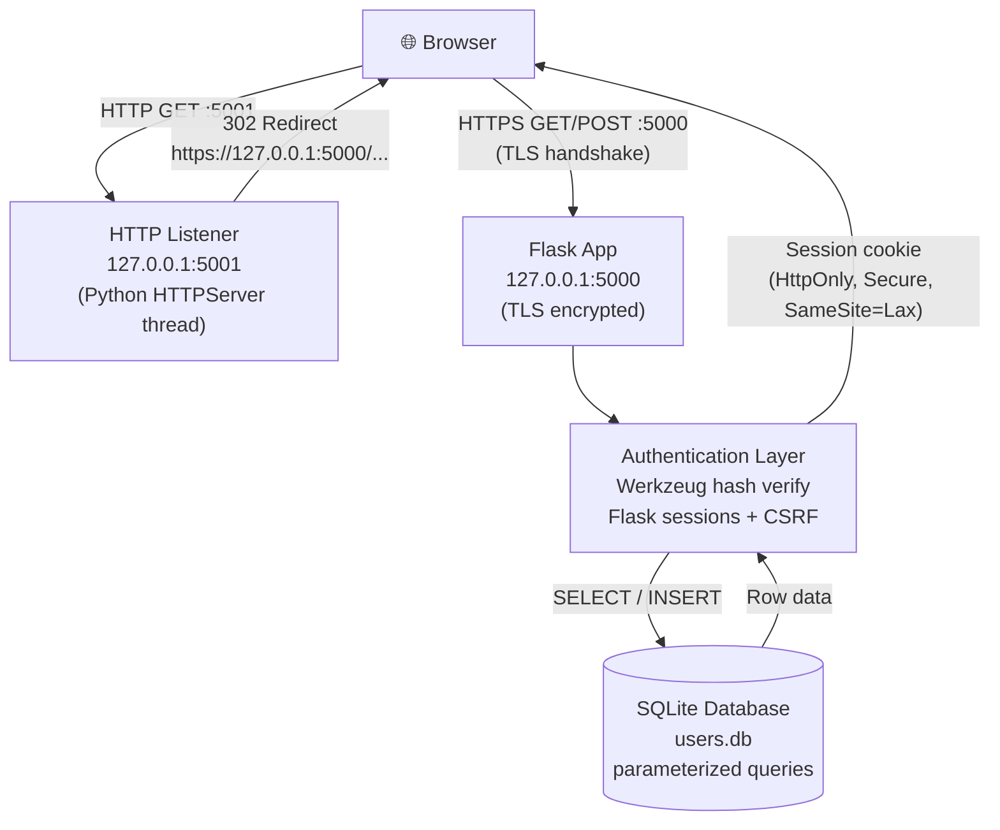

# Architecture — SSL/TLS Secure Web Application

## Overview

The application runs two local servers:

| Server | Port | Protocol | Purpose |
|--------|------|----------|---------|
| Flask HTTPS App | 5000 | HTTPS / TLS | Main application |
| HTTP Redirect Listener | 5001 | HTTP | Redirects to HTTPS |

## Architecture Diagram



## Key Security Flows

### Registration
1. User submits form → CSRF token validated by Flask-WTF
2. Server validates input (length, charset)
3. `generate_password_hash()` produces PBKDF2/Scrypt hash
4. Hash stored in SQLite via parameterized INSERT

### Login
1. CSRF token validated
2. `check_password_hash()` performs timing-safe comparison
3. On success: `session.clear()` (session-fixation prevention), new session set
4. Generic error on failure (no username enumeration)

### HTTP → HTTPS Redirect
- Target is always `https://127.0.0.1:5000` + path
- Host header is ignored — no open-redirect risk

## File Structure

```
cs project/
├── app.py                  # Main application (factory + routes)
├── requirements.txt
├── README.md
├── .env.example
├── .gitignore
├── start.bat               # Windows startup script
├── gen_cert.bat            # Certificate generation helper
├── cert.pem / key.pem      # (root-level fallback) or certs/
├── certs/                  # Preferred cert location
│   ├── cert.pem
│   └── key.pem
├── templates/              # Jinja2 templates
│   ├── base.html
│   ├── index.html
│   ├── register.html
│   ├── login.html
│   ├── dashboard.html
│   ├── security.html
│   ├── 404.html
│   └── 500.html
├── static/
│   ├── css/style.css
│   └── js/main.js
├── tests/
│   ├── __init__.py
│   └── test_app.py
└── docs/
    ├── architecture.md     ← this file
    ├── testing.md
    └── viva.md
```
